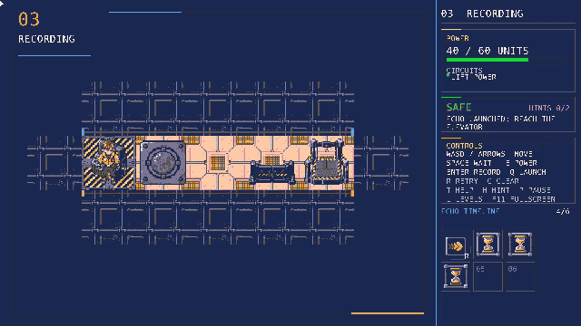
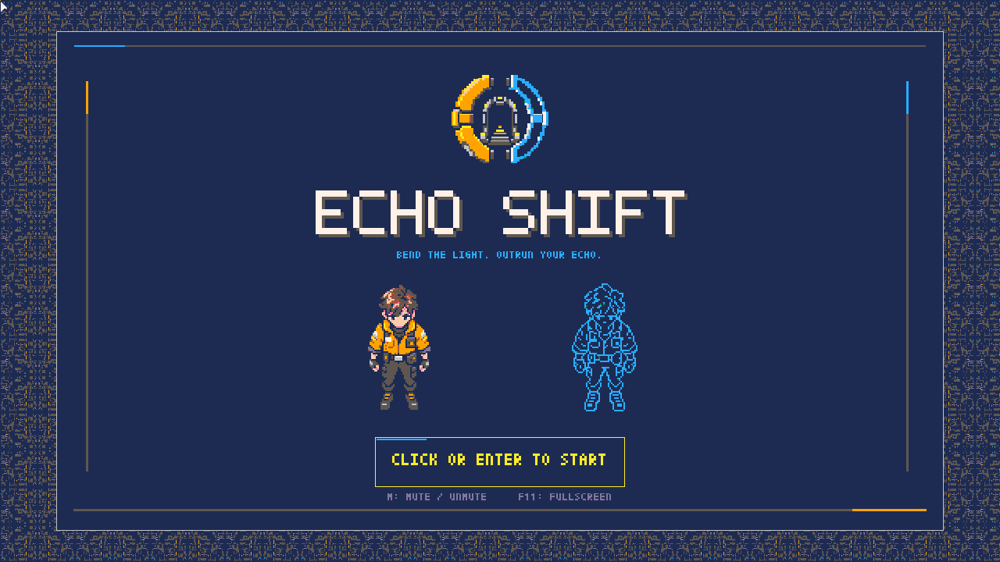
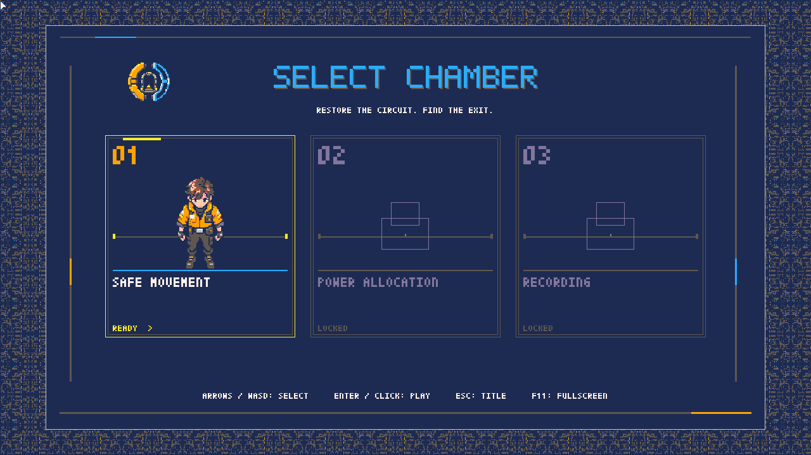
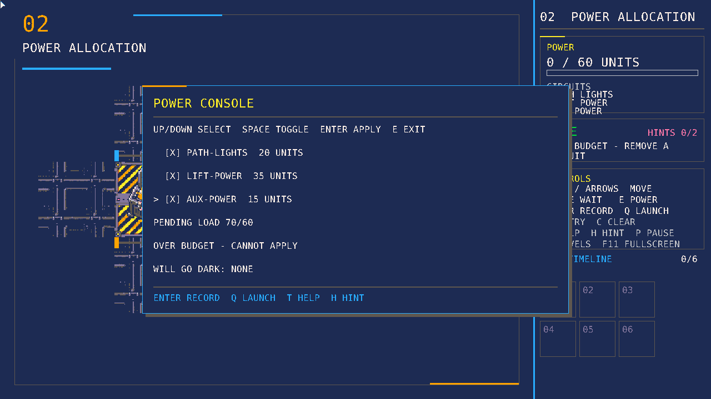
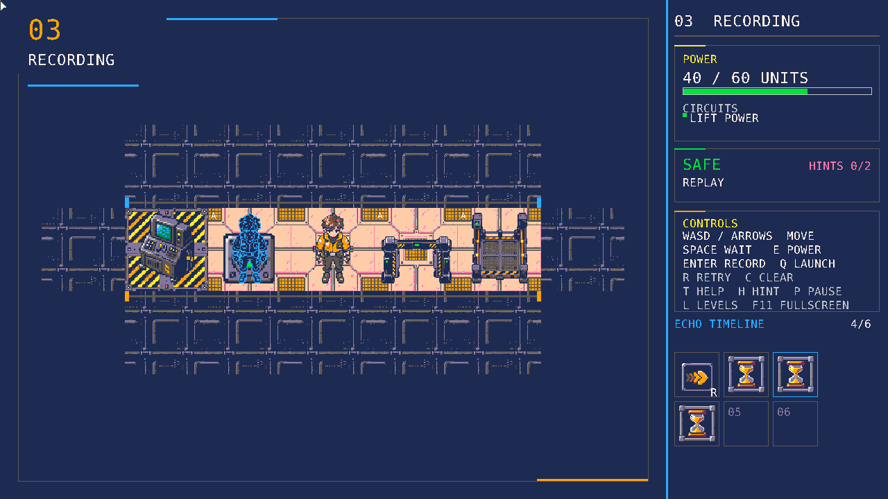

# Echo Shift

Echo Shift is a single-player, top-down, turn-based puzzle game. You play a
technician escaping a series of dark, under-powered chambers. A small power
grid can light only some of the rooms and machines at once, and pressure pads
only stay active while something stands on them. To get through, you record a
short sequence of moves, then replay it as an **echo**: a ghost copy of
yourself that walks the recorded route while you take a different one.

The game is written in Python with [Pyxel](https://github.com/kitao/pyxel). It
runs on Windows, macOS and Linux; the primary target is Windows 11.



## Quick start

You need [Git](https://git-scm.com/) and [uv](https://docs.astral.sh/uv/). uv
downloads the pinned Python 3.12 by itself, so no separate Python install is
needed.

Install uv on Windows (PowerShell):

```powershell
powershell -ExecutionPolicy ByPass -c "irm https://astral.sh/uv/install.ps1 | iex"
```

Install uv on macOS or Linux:

```bash
curl -LsSf https://astral.sh/uv/install.sh | sh
```

Then, on any platform, from a new terminal:

```bash
git clone https://github.com/ParallaX07/Echo_Shift.git
cd Echo_Shift
uv sync                 # create the environment and install dependencies
uv run echo_shift       # play the game
uv run all_tests        # run the full test suite (same as uv run pytest -q)
```

`uv run python main.py` also starts the game. On Linux, run it from a graphical
desktop session with the system's graphics and audio libraries available.

## How to play

The title screen opens a level select screen. Click Start or press Enter, then
use WASD/arrow keys and Enter or the mouse to choose an unlocked chamber.
The six chambers each teach one idea: safe movement, power allocation,
recording, replay in darkness, timed pads and a final escape that combines
them. Each chamber offers a guided lesson (Enter) or free play (F). In a guided
lesson the **Next step** line at the top says what to do and a yellow outline
shows where; doing it moves the lesson on, and a short card appears only when a
step introduces a new idea. Press T for the guide (goal, controls, objects, echo,
power, hints and the precise rules), hover objects and bar fields for live
explanations, or H to reveal the next hint. The bottom bar shows buttons as the
chambers introduce them. See [the lessons and the guide](docs/tutorials.md).

| Title screen | Chamber select |
|---|---|
|  |  |
| **Power console** | **Echo on a pad** |
|  |  |

### Saves and logs

Progress is saved as `progress.json` in the per-user data directory. Each
chamber visit is also written to `playtest.jsonl` there when it ends or the
game closes; the record is anonymous and contains no inputs. The startup log is
`startup.log` in the same place.

| Platform | Per-user data directory |
|---|---|
| Windows | `%APPDATA%\EchoShift` |
| macOS and Linux | `$XDG_DATA_HOME/echo-shift`, by default `~/.local/share/echo-shift` |

Delete `progress.json` to lock all chambers again.

### Controls

| Key | Action |
|---|---|
| WASD / arrow keys | Move one tile (one turn) |
| Space | Wait one turn |
| Enter (or F) | The echo key: start a recording (in the hub), save it (anywhere), or launch the echo (in the hub) |
| E | Open or close the power console (at the console) |
| Z / Backspace | Undo the last accepted input (unlimited) |
| R | Retry the launched recording from its starting snapshot |
| C | Restart the chamber and clear power and recording |
| H | Reveal the next hint (opens the guide on its Hints page) |
| T | Open or close the guide |
| Esc / P | Pause menu: resume, undo, retry, restart, re-record, chamber select (L), settings, controls, quit to title |
| M | Toggle mute |
| F11 / Alt+Enter | Toggle fullscreen |

A gamepad plays the whole game too (the first connected pad; the sticks are
not used):

| Button | Action |
|---|---|
| D-pad | Move one tile; hold to keep walking |
| A | Wait one turn (confirm in menus and cards) |
| X | The echo key: record, save or launch (apply at the console) |
| Y | Open or close the power console, or read a log terminal |
| B | Undo the last accepted input (back out of the console, guide, menus and log cards) |
| LB / RB | Preview an earlier or later turn of the saved recording |
| Start | Pause menu (resume it too) |
| Back | Open or close the guide |

Retry, restart, hints, mute and fullscreen have no pad button; the pause menu
offers retry and restart and the guide reveals hints. The bottom bar and the
guide show the pad button names after you last used the pad, and key names after
you last used the keyboard or mouse.

At the console, use Up/Down to select a circuit and Space to toggle it. Before
you record and after you save, a switch takes effect at once; while recording or
replaying it waits for Enter, which costs one turn. E closes the console.

The bottom bar introduces its buttons gradually: chamber 1 shows move, wait,
undo, the console and the echo key, chamber 3 adds Retry and Re-record, and later
chambers show everything. A new button blinks for a few seconds. The keys of
hidden buttons always work, and the guide's Controls page lists what the
chamber has introduced.

In the guide, the arrow keys or WASD (or the previous and next rows) change
page, and Esc, E or a right-click closes it. The pause menu has a Settings panel
with music volume, SFX volume, mute, reduced motion, an optional CRT look
(scanlines, off by default) and fullscreen (use Left and Right, or click a row's
left or right half); settings are saved with your progress.

The mouse plays the whole game too: click a tile next to the technician to move,
the technician's own tile to wait (or to open the console while standing on it),
any bar button, console row, timeline slot, failure-card or pause-menu option to
use it, and right-click to close the console, guide or pause menu. Clicks do
exactly what the matching key does.

The game starts windowed at up to 1280×720. Press F11 or Alt+Enter to toggle
fullscreen. The room fills the middle of the window with a top bar (chamber,
power, circuits, safety and the Next step line) above it and a bottom bar
(timeline, turns left and action buttons) below it. The power console opens as a
drawer beside the room and never covers it.

## Game rules

The full, as-built rules with worked turn examples are in
[`docs/rules.md`](docs/rules.md). In summary:

**The chamber.** Each chamber is a grid of floor, walls, a hub, pads, gates and
an elevator exit. The **hub** is always lit, always safe and holds the power
console. Ending a turn on an unlit tile outside the hub fails the attempt.

**Power.** Each chamber has a fixed capacity (for example 60 units). Circuits
have a load and power some light zones and devices. Power is a *simultaneous
limit*, not a battery: any set of circuits whose loads fit the capacity can be
on at once, and an over-budget configuration is refused rather than reduced.
Changing power in the hub before launch is free; during replay it costs a turn.

**Pads and devices.** A pad is *occupied* while a body stands on it and *active*
while occupied or while its timer is above zero. A timed pad's timer resets
while occupied and counts down by one each turn after you leave (3 by
default). A passive pad has no timer. A gate opens and an elevator runs only
when its circuit is powered **and** its linked pad is active. You win by
standing on a running elevator.

**Recording and the echo.**

1. Stand in the hub and press Enter to start a take. That tile is the echo's
   start.
2. Move and wait. Each accepted action is recorded, up to the chamber's
   `max_turns` limit (at most 12).
3. Press Enter to save the recording. You return to the start with the recording kept.
4. Press Enter in the hub to launch. The chamber resets, your power choice is kept,
   and the echo appears at its start. Recorded command *k* plays on turn *k*.

There is one recording and one echo at a time. The echo ignores darkness, can
overlap you and pass open gates, and is blocked by closed ones. Its only effect
on the world is standing on pads; it does not power or operate machines. A
blocked echo command is used up and the echo stays put. After its last command
the echo holds its final tile for one more turn, then disappears.

**Turn order.** Every accepted action advances one turn, resolved in this order:

1. Remove an expired echo, then refresh pads and linked devices.
2. Apply a power change, then refresh linked devices.
3. Move the player and the echo using the current gate state.
4. Update pad occupancy and timers, then refresh linked devices.
5. Check player safety and the exit.

**Mistakes are free.** Moving into a wall or closed gate is refused and costs
nothing. Menus, the guide, hints and hovering never advance turns. Undo (Z) steps
back one accepted input as often as you like, and retries are unlimited: R restores the launch snapshot with the same recording, and C
returns to preparation with power and recording cleared. A failure during
replay restores the launch snapshot; a failure while recording discards that
take.

## Tech stack

| Role | Choice |
|---|---|
| Language | Python 3.12 (pinned in `.python-version`) |
| Game engine | Pyxel 2.9 (pinned in `uv.lock`) |
| Environment and dependencies | uv |
| Level data | JSON, validated by a hand-written loader using dataclasses |
| Tests | pytest |
| Lint and format | ruff |
| Image tooling | Pillow (development only, not shipped) |
| Packaging | `pyxel package` and `pyxel app2exe` (on Windows) |

## Architecture

The code is split into a **headless rules engine** and a **Pyxel UI**:

```
          input (keys, mouse)
                 │
                 ▼
┌──────────────────────────────────┐
│ ui/  (Pyxel)                     │  screens, rendering, HUD,
│  app.py  tutorial.py  guide.py   │  tutorial, guide, saves,
│  hud.py  layout.py  atlas.py ... │  telemetry
└──────────────┬───────────────────┘
               │ actions in, immutable state out
               ▼
┌──────────────────────────────────┐
│ engine/  (pure Python, no Pyxel) │  grid, power, light,
│  turn.py  recording.py  power.py │  recording, echo replay,
│  lighting.py  model.py loader.py │  turn resolution
└──────────────┬───────────────────┘
               │ loads
               ▼
      levels/*.json   assets/atlas.*
```

- **Headless engine.** All rules live in `src/echo_shift/engine/`, which never
  imports Pyxel. This keeps every rule testable without a window.
- **Immutable, deterministic state.** The engine's state objects are frozen
  dataclasses. A turn takes a state and an action and returns a new state, so
  the same chamber and inputs always produce the same result. Retry snapshots
  are just saved state values.
- **One turn function.** `engine/turn.py` implements the turn order above in
  one place. `engine/recording.py` adds the recording controls (start, commit,
  launch, retry, clear) on top of it.
- **Data-driven chambers.** Chambers are JSON files in `levels/`. Nothing is
  hard-coded per level. `engine/loader.py` validates links, positions, unique
  IDs, circuit capacity and turn limits when a chamber loads. Guided lesson
  steps and hints live in the same JSON.
- **UI as a thin layer.** `ui/` reads input, turns it into engine actions and
  draws the result. Pure helpers such as `hud.py`, `help.py`, `layout.py` and
  `tutorial.py` derive what to show from engine state without Pyxel, so they
  are unit-tested too.
- **Sprites by id.** Game code refers to sprites only by id. `ui/atlas.py`
  looks them up in the packed `assets/atlas.png` / `assets/atlas.json`.
- **Two kinds of paths.** `paths.resource_path()` resolves read-only bundled
  files relative to `main.py`. `paths.user_data_dir()` is the only place that
  saves and logs are written (see [Saves and logs](#saves-and-logs)), never
  next to the executable.

### Art pipeline

All sprites are 96×96 pixel art in the locked PICO-8 16-colour palette
(`assets/palette.json`; index 0 is reserved as the transparent key). Darkness is
drawn at render time with a palette remap, not with separate sprites.

1. Each sprite has an entry in `assets/manifest.json` (id, type, group, prompt,
   status). The style rules are in `assets/style/STYLE_BIBLE.md`.
2. Source images go in `assets/raw/`.
3. `tools/process_asset.py <id>` crops, fits, palette-snaps and binarizes alpha
   into `assets/sprites/<id>.png`. Frames in one group share a scale and anchor.
4. `tools/validate_assets.py` checks size, RGBA, binary alpha, palette and
   coverage.
5. `tools/contact_sheet.py` writes review sheets, tile repeats and animated
   GIFs to `assets/preview/`.
6. `tools/pack_atlas.py` packs the sprites into the atlas used by the game.

## Project structure

```
.
├── main.py                     # entry point; bundled resources resolve from here
├── pyproject.toml  uv.lock  .python-version
├── src/echo_shift/
│   ├── cli.py                  # `echo_shift` script: logging, then runs main.py
│   ├── paths.py                # bundled resources vs per-user data directory
│   ├── engine/                 # headless rules, no Pyxel
│   │   ├── model.py            # immutable tiles, circuits, pads, devices, state
│   │   ├── power.py            # capacity checks and power configuration
│   │   ├── lighting.py         # lit and safe tile queries
│   │   ├── turn.py             # the canonical turn resolution
│   │   ├── recording.py        # record, commit, launch, retry, clear
│   │   ├── search.py           # exhaustive solver: optima, goals, shortcut checks
│   │   └── loader.py           # chamber JSON loading and validation
│   └── ui/                     # Pyxel input and rendering
│       ├── app.py              # screens, input handling and drawing
│       ├── atlas.py            # sprite lookup by id
│       ├── display.py          # desktop and window size
│       ├── layout.py           # room, top bar and bottom bar measurements
│       ├── hud.py              # HUD data derived from engine state
│       ├── controls.py         # key bindings, available actions, button disclosure
│       ├── help.py             # hover explanations
│       ├── guide.py            # the guide's pages
│       ├── tutorial.py         # guided lesson data and progress
│       ├── progress.py         # unlocked chambers, goals met and settings save
│       ├── goals.py            # run cost, result-card lines and level-card marks
│       └── telemetry.py        # anonymous per-visit playtest records
├── levels/
│   ├── chamber_01..06.json     # the six playable chambers
│   ├── fixtures/               # test-only chambers
│   └── solutions/              # recorded solutions and goal traces replayed by the tests
├── assets/
│   ├── palette.json            # locked palette and validation thresholds
│   ├── manifest.json           # sprite catalogue and provenance
│   ├── atlas.png  atlas.json   # packed sprites used by the game
│   ├── raw/  sprites/          # source images and processed 96×96 sprites
│   ├── preview/                # contact sheets, tile repeats, idle GIFs
│   ├── style/                  # style bible and reference images
│   └── fonts/                  # bundled UI font and its licence
├── tools/
│   ├── process_asset.py  validate_assets.py  contact_sheet.py  pack_atlas.py
│   ├── solve.py                # solve chambers: difficulty table, goals, traces
│   ├── spike_process.py        # downscale filter comparison
│   └── stage_build.py          # stage build/app/ for packaging
├── tests/
│   ├── engine/                 # turn order, timing, power, light, loader, echo
│   ├── solutions/              # every chamber solution replays and needs its echo
│   ├── assets/                 # manifest, processing, validation, atlas
│   └── ui/                     # headless UI logic, menus, layout, tutorial
└── docs/
    ├── rules.md                # as-built rules with worked turn examples
    └── tutorials.md            # guided lessons and the guide
```

## Development

```bash
uv sync
uv run pytest -q
uv run ruff check . && uv run ruff format --check .
uv run python tools/validate_assets.py
uv run python main.py
```

The tests cover the engine timing rules one by one, replay every chamber's
recorded solution, validate every sprite and exercise the UI logic headlessly.

## Building a standalone game

The same commands work on Windows, macOS and Linux. Run them from the
repository root on the platform you are building for: PyInstaller, which
`app2exe` uses, cannot cross-compile, so a Windows executable has to be built
on Windows.

```bash
uv sync
uv run python tools/stage_build.py                # copy the game and its resources to build/app/
uv run pyxel package build/app build/app/main.py  # write app.pyxapp
uv run pyxel play app.pyxapp                      # optional: try the packaged game
uv run --with pyinstaller pyxel app2exe app.pyxapp
```

`app2exe` writes the game to `dist/app/`, with its bundled runtime under
`dist/app/_internal`, and deletes the temporary `build/` folder when it
finishes. Distribute the whole `dist/app/` folder.

| Platform | Executable |
|---|---|
| Windows | `dist\app\app.exe` |
| macOS | `dist/app/app` (PyInstaller may also write `dist/app.app`) |
| Linux | `dist/app/app` |

The executable can run from any directory. It reads its resources from the
bundle and writes saves and logs to the per-user data directory above.

`app.pyxapp` on its own is a portable package: anyone with Pyxel installed can
run it on any platform with `pyxel play app.pyxapp`.
