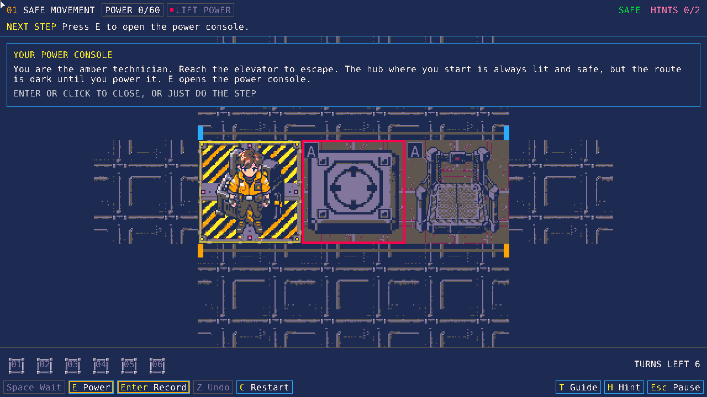
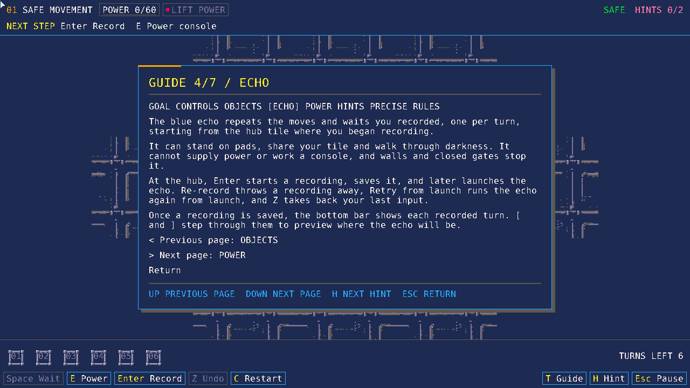

# Guided lessons and the guide

Every chamber visit starts with a choice. **Enter starts the guided lesson**;
**F starts free play**. Previously unlocked chambers offer both choices again.
Reading or selecting a mode never advances the engine. Existing progress saves
continue to contain only the highest `unlocked` chamber.

A guided step is one instruction. It sits on the **Next step** line at the top
of the screen, and a yellow outline marks its target tile, timeline slot or
status field (a yellow `*` marks a target circuit in the power console). Doing
the action advances the lesson; there is no separate "acknowledge" press. A
wrong gameplay action is refused without changing power, positions, timers,
recording or turns, and the Next step line shows the instruction again. Console
selection remains available. A step advances only after its expected action and
actual outcomes match, never merely from pressing a key.

A card appears only when a step introduces a new idea (a step marked
`"concept": true`). It sits at the top of the room, never covers the controls,
and closes when you do the action, press Enter or click it.

Lesson text is plain words with no turn arithmetic; the exact timing is on the
guide's Precise rules page. Level JSON never hard-codes key names: text uses
placeholders such as `{key:echo}` and `{label:retry}`, which the action table in
`ui/controls.py` fills in when the text is shown, so the screen always matches
the real keys.

## Buttons appear as they are needed

The bottom bar introduces its buttons chamber by chamber. Chamber 1 shows move,
wait, undo, the power console and the echo key (its lesson needs both, because
recording and launching start in the hub).
Chamber 3 adds Retry and Re-record, which only matter once you have an echo, and
later chambers show everything. Restart, pause, guide, hint, mute and fullscreen
are always shown. A newly shown button blinks for a few seconds the first time
its chamber opens (it stays lit with reduced motion). Hidden actions are only
left off the bar and the guide's Controls page; their keys always work.

## Lessons

The console is a short walk from the start, so every lesson begins with a walking
step (one step, several key presses: it finishes when the technician stands on
the console, and the card for the idea closes with the first press). A recording
begins where the technician stands, so lessons that need the start tile walk
back to it first, and chamber 3 records from the console itself. Chamber 1
teaches the technician, hub, free walking on lit floor, lighting, console,
empty-take launch, movement, timed pads and elevator completion. Chamber 2
deliberately tries the lift on its own (35/30) and observes the rejection, lights
the wings with the lamp, walks west to the energy cell, returns to the console,
swaps the lamp for the route lights and the lift (50/50) and uses the timed pad's
active window. Chamber 3 records four moves and a wait, introduces Retry and
Re-record, then uses the echo to hold a passive pad in the west corridor while
crossing the gate in the east one.

Chamber 4 lights a side nook to record a walk onto its pad, then swaps the lights
for the machines (the generator cannot run both) so the echo holds the pad in the
dark. Chamber 5 walks through a gate on a timed pad's countdown and parks the echo
on a second pad. Chamber 6 combines the dark pad, the power swap and a countdown
that holds the second gate and the lift. Each lesson has one or two concept cards
and ends with the same replay steps as the chamber's recorded solution.

## The guide

**T opens the guide**, which merges help and hints. Its seven pages are Goal,
Controls (generated from the action table, showing only what the chamber has
introduced), Objects (the live explanation of each pad and machine), Echo, Power,
Hints and Precise rules (the exact timing in plain words). The arrows or WASD, or
the previous and next rows, change page; Esc, E, T or a right-click returns to
the lesson or the game. The guide is also reachable from an open console.

**H reveals the next hint** and opens the guide on the Hints page, which lists
the revealed hints and how many remain. Each reveal is counted once. Returning
preserves the objective.

**Esc or P pauses** and resumes the same step. The pause menu holds Resume, Undo,
Retry from launch, Restart chamber, Re-record, Chamber select, Settings
(music and SFX volume, mute, reduced motion, fullscreen), Controls (opens the
guide's Controls page) and Quit to title. **C clears power and recording and
restarts a guided lesson**. **R after launch restores the engine's launch
snapshot**; during a lesson it returns guidance to the first replay action. R
before launch has no effect. F11 and Alt+Enter remain fullscreen shortcuts.

Hover room objects, circuit rows, the power meter, safety state, chamber heading
or timeline slots for live explanations. Timed pads show occupied and active
flags and remaining countdown separately. Devices show their circuit and linked
pad requirements. Timeline slots identify commands and the next replay command.
Hovering never performs an action or advances the lesson.

## Content and verification

Chamber JSON has optional `tutorial_steps`, `hints` and `lesson_summary` fields.
Each step has a unique `id`, an `objective` (the Next step line), an `action`,
`expected` outcomes and a `target` highlight. A step with `"concept": true` also
needs a `title` and an `explanation` for its card. UI loading validates required
fields, supported actions/outcomes, coordinates, circuit/pad/gate references,
timeline indices and every `{key:...}` / `{label:...}` placeholder in lesson,
hint and summary text. Fixtures without `tutorial_steps` still work. The tutorial controller
and explanation functions do not import Pyxel; they observe the real engine.
There is no alternative tutorial simulation or modification of timing rules.

Chamber JSON may also list `terminals` (see "Log terminals" in `docs/rules.md`).
They are validated by `ui/story.py`, ignored by the engine and never part of a
lesson step.

Local visit telemetry includes `mode` (`guided` or `free`) so moderator findings
can distinguish the experiences. The deliberately rejected request is counted
as an over-budget confirmation.

Run the automated checks with `uv run pytest -q`.
